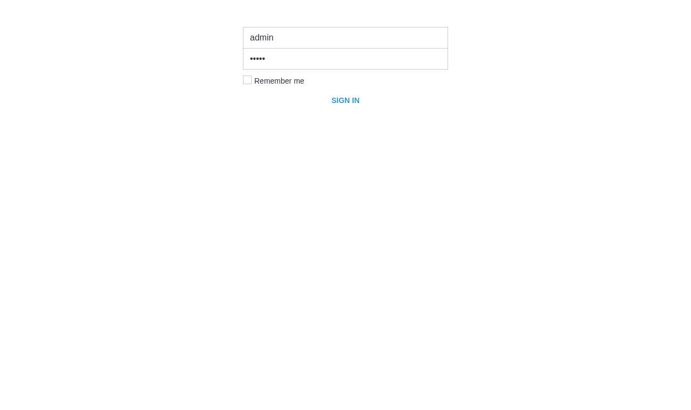
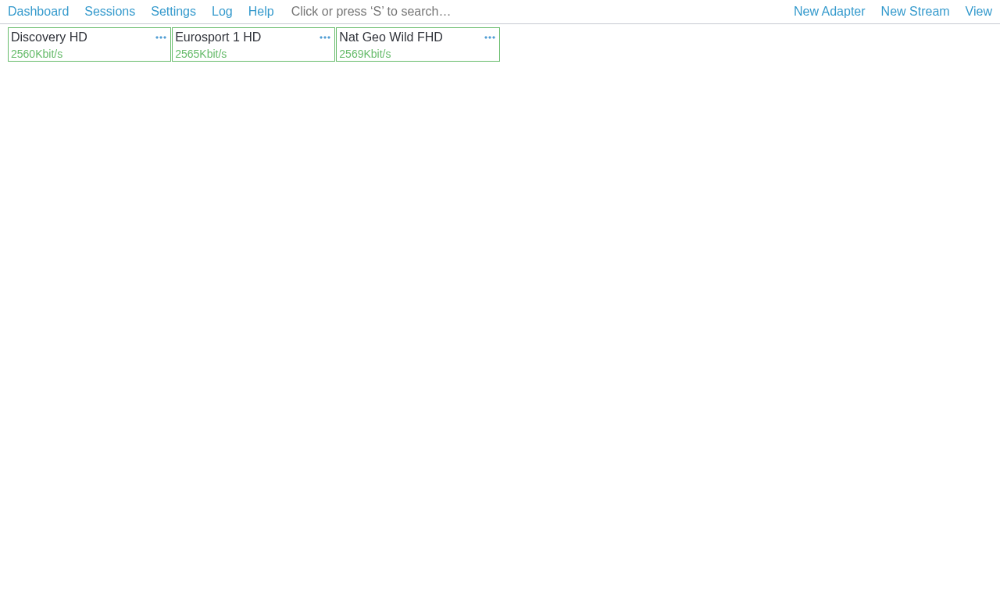

# AstraG — High-Performance IPTV & MPEG-TS / HLS Broadcast Server (Ubuntu 22.04 / 24.04)

**AstraG** — высокопроизводительный сервер приёма, анализа и вещания потоков **MPEG-TS (`.ts`)** и **HLS (`.m3u8`)** с веб-панелью управления **AstraG Control Panel** (полная совместимость с архитектурой **Cesbo Astra**).

---

## Скриншоты интерфейса AstraG

### 1. Окно входа в панель управления (`admin` / `admin`)


### 2. Основное окно управления потоками (Dashboard)


---

## 2 варианта быстрой установки одной командой (Ubuntu 22.04 / 24.04)

Установщик `install.sh` не создаёт тяжеловесное виртуальное окружение `venv` в `/opt/astrag` и поддерживает **два режима установки на выбор**:

---

### Вариант 1 (По умолчанию): Установка только из системных APT-пакетов Ubuntu (`apt`) вообще без `pip` и `venv`

Устанавливает зависимости исключительно из официальных системных репозиториев Ubuntu (`python3-fastapi`, `python3-uvicorn`, `python3-pydantic` и др.) и запускает сервер напрямую через системный `/usr/bin/python3` без `pip` и без `venv` (минимальное потребление RAM и CPU):

```bash
curl -fsSL https://raw.githubusercontent.com/udemika/astrag/main/install.sh | sudo bash -s -- --apt --start --port 8000
```

Или через клонирование репозитория:

```bash
rm -rf /tmp/astrag && git clone https://github.com/udemika/astrag.git /tmp/astrag && sudo bash /tmp/astrag/install.sh --apt --start --port 8000 && rm -rf /tmp/astrag
```

---

### Вариант 2: Сборка в один бинарный файл (`/opt/astrag/astrag`) как оригинальный бинарник Cesbo Astra

Компилирует весь движок `AstraG`, веб-интерфейс и все библиотеки в **один автономный исполняемый бинарный файл** `/opt/astrag/astrag` (и `/usr/bin/astrag`), после чего удаляет сборочные файлы:

```bash
curl -fsSL https://raw.githubusercontent.com/udemika/astrag/main/install.sh | sudo bash -s -- --binary --start --port 8000
```

Или через клонирование репозитория:

```bash
rm -rf /tmp/astrag && git clone https://github.com/udemika/astrag.git /tmp/astrag && sudo bash /tmp/astrag/install.sh --binary --start --port 8000 && rm -rf /tmp/astrag
```

---

> **После выполнения любой из команд панель сразу доступна по адресу:**
> * **Веб-интерфейс:** `http://<IP_ВАШЕГО_СЕРВЕРА>:8000`
> * **Логин по умолчанию:** `admin`
> * **Пароль по умолчанию:** `admin`
> * **Общий плейлист каналов (M3U8):** `http://<IP_ВАШЕГО_СЕРВЕРА>:8000/playlist.m3u8`

---

## Обновление AstraG на сервере Ubuntu

Обновить движок и перезапустить сервис (с полным сохранением всех потоков и пользователей в `/var/lib/astrag/state.json`):

* **Обновление в режиме системных пакетов (`--apt`):**
```bash
curl -fsSL https://raw.githubusercontent.com/udemika/astrag/main/install.sh | sudo bash -s -- --apt --update --port 8000
```

* **Обновление с пересборкой в один бинарный файл (`--binary`):**
```bash
curl -fsSL https://raw.githubusercontent.com/udemika/astrag/main/install.sh | sudo bash -s -- --binary --update --port 8000
```

---

## Полное удаление AstraG с сервера (Uninstall)

Чтобы **полностью удалить** `AstraG` (включая бинарник, systemd-сервисы, конфигурации `/etc/astrag` и базу состояния `/var/lib/astrag`), выполните одну команду:

```bash
curl -fsSL https://raw.githubusercontent.com/udemika/astrag/main/uninstall.sh | sudo bash
```

Или одной строкой напрямую:

```bash
sudo systemctl stop astrag astra-clone 2>/dev/null || true && sudo systemctl disable astrag astra-clone 2>/dev/null || true && sudo pkill -f "astra_clone_backend.py|astrag_backend.py|/opt/astrag/astrag" 2>/dev/null || true && sudo rm -f /etc/systemd/system/astrag.service /etc/systemd/system/astra-clone.service /usr/bin/astrag /usr/bin/astra-clone && sudo systemctl daemon-reload && sudo rm -rf /opt/astrag /opt/astra-clone /etc/astrag /etc/astra-clone /var/lib/astrag /var/lib/astra-clone && sudo userdel astrag 2>/dev/null || true && sudo userdel astra-clone 2>/dev/null || true && echo "AstraG полностью удалён"
```

---

## Основные возможности движка (`stream_engine.py` + `astrag_backend.py`)

* **Приём потоков (INPUT LIST):**
  * `http://` и `https://` — прямые потоки MPEG-TS и HLS-плейлисты (`.m3u8` / `.m3u`, включая Master/Variant плейлисты) через встроенный высокоскоростной `asyncio` HTTP/1.1 Keep-Alive клиент с предзагрузкой (`sync_buffer`) и VBR-пейсингом по 27 МГц меткам **PCR**.
  * `udp://` и `rtp://` — Unicast и Multicast (`?interface=IP` / `#localaddr=IP`) с увеличенным буфером сокета `SO_RCVBUF = 2 МБ`.
  * Автоматический **Failover** (резервирование между несколькими входами `#1`, `#2`, ...) и фильтрация по `#pnr=`, `#filter=`, `#no_sdt`, `#no_eit`.
* **Отдача потоков (OUTPUT LIST и встроенные ссылки):**
  * Встроенная отдача **MPEG-TS (`.ts`)**: `/play/<id>.ts`, `/play/<id>`, `/live/<id>.ts` с выравниванием входа по ключевому кадру видео (**Clean Entry Gate: IDR + Audio PUSI**) и пакетированием по `32 КБ`.
  * Встроенная отдача **HLS (`.m3u8`)**: `/play/<id>.m3u8`, `/play/<id>/index.m3u8` с нарезкой сегментов строго по ключевым кадрам **H.264 / HEVC IDR** и непрерывной синхронизацией `Continuity Counter (CC)`.
  * Произвольные **HTTP Outputs** в `OUTPUT LIST` (например, `http://0.0.0.0:18000/1` или `http://<IP>:18000/mychannel.ts`) с автоматическим поднятием дополнительных HTTP-портов.
  * Вещание в **UDP Unicast / Multicast** (`udp://239.x.x.x:1234?ttl=32`) с пакетированием по 7 TS-пакетов (`1316 байт <= 1500 MTU`).
* **Анализатор потока и управление пользователями:**
  * Полный разбор таблиц `PAT`, `PMT`, `SDT`, `NIT` (с кэшированием CRC32 неизменных секций), контроль ошибок `CC` и `PES`, детектор скремблирования (`Analyze` в карточке потока).
  * Управление пользователями, ролями и токенами доступа в `Settings -> Users`.

---

## Структура путей на сервере Ubuntu

| Путь | Назначение |
| --- | --- |
| `/opt/astrag/` | Исполняемый бинарник `/opt/astrag/astrag` (в режиме `--binary`) или модули движка (в режиме `--apt`) |
| `/opt/astrag/www/` | Веб-интерфейс (`index.html`, `mod.js`, `account.html`) |
| `/etc/astrag/astrag.conf` | Конфигурация сервиса (`ASTRA_HOST`, `ASTRA_PORT`) |
| `/var/lib/astrag/state.json` | База данных потоков, настроек и пользователей |
| `/usr/bin/astrag` | CLI-команда запуска сервера |
| `/etc/systemd/system/astrag.service` | Unit-файл systemd |

